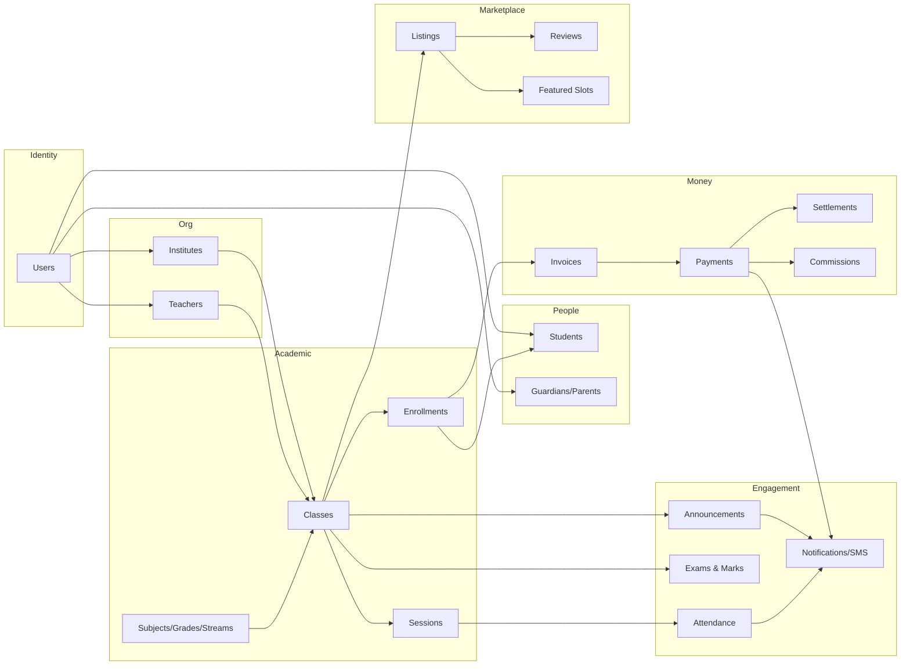
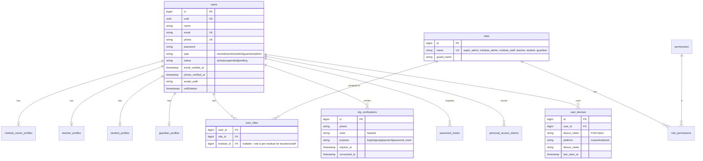
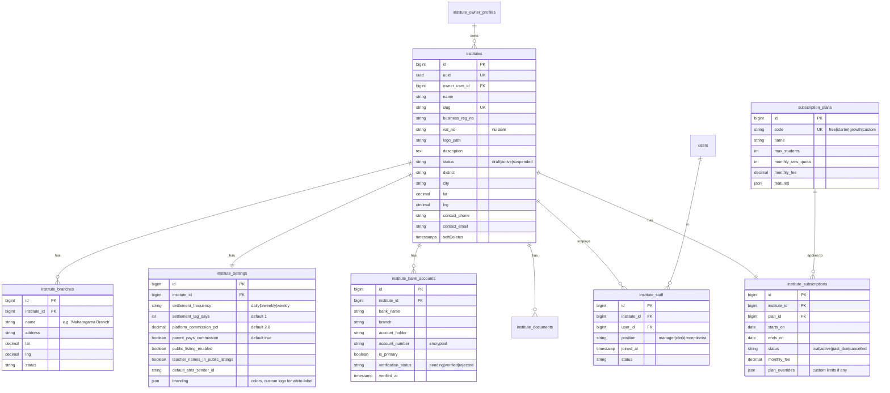
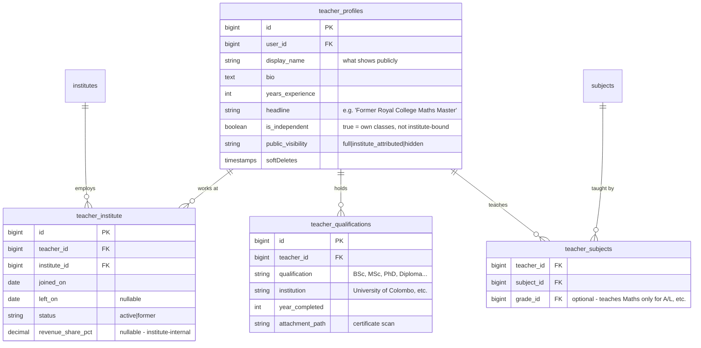
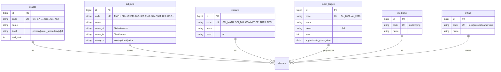
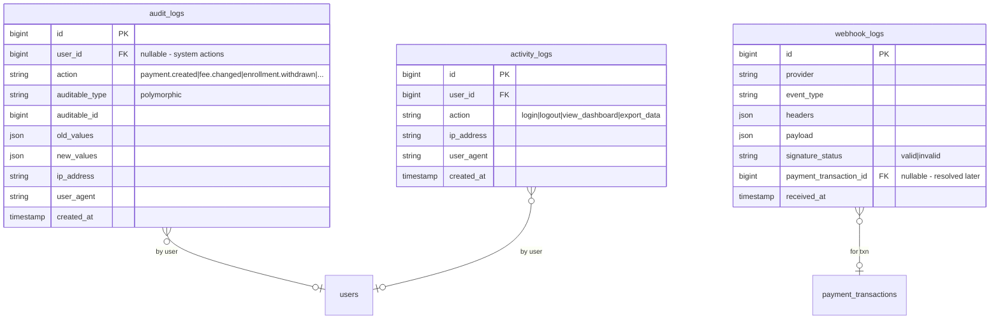

# TuitionHub — Entity-Relationship Schema

**Companion to:** TuitionHub Business Plan & Strategic Brief
**Prepared for:** SCITS
**Stack assumed:** Laravel 10/11, MySQL or PostgreSQL, Flutter clients

---

## 0. How to read this document

This is the full database design for TuitionHub, organised by module. Each module has:

1. A **Mermaid ER diagram** you can render in any markdown viewer (GitHub, GitLab, VSCode, Obsidian).
2. A **table-by-table breakdown** with key columns, relationships, and notes.
3. A **phase tag** so you know what to build in Phase 1 MVP vs later phases.

### Phase tags

| Tag | Meaning |
|-----|---------|
| `[P1]` | Phase 1 MVP — single-institute end-to-end. Build this. |
| `[P2]` | Phase 2 — public marketplace, mobile apps, multi-institute. |
| `[P3]` | Phase 3 — scale features (online exams, white-label, etc.). |
| `[OPT]` | Optional / nice-to-have. Skip unless asked. |

### Naming conventions

- All tables: **snake_case, plural** (Laravel convention): `students`, `class_enrollments`, `payment_transactions`.
- Pivots: **alphabetical singular_singular** unless a custom name is meaningful: `class_student` if generic, `class_enrollments` if it carries data.
- Primary keys: `id` (auto-increment `bigint unsigned`).
- Public-facing IDs: every public-routable entity also has a `uuid` column with a unique index. Use this in marketplace URLs (`/class/{uuid}`), never expose internal IDs.
- Foreign keys: `{singular_table}_id` — `institute_id`, `class_id`, `student_id`.
- Timestamps: every table has `created_at` and `updated_at` (Laravel default).
- Soft deletes: `deleted_at` on every table **EXCEPT** payment/settlement/audit tables (those are immutable history).
- Money: store as `bigint` cents/sub-unit, OR `decimal(15,2)`. Pick one and never mix. Recommended: `decimal(15,2)` with currency `'LKR'`.
- Status fields: use enum-style varchar(32), document allowed values in a comment, no DB enum types (Laravel migrations cope poorly with enum changes).

### Cross-cutting design decisions

1. **Single `users` table** with a `type` discriminator + extension tables (`institute_owner_profiles`, `teacher_profiles`, etc.). One person can hold multiple roles via `user_roles`.
2. **Money tables are append-only.** Payments, settlements, commissions, refunds — never update money rows after creation. Status transitions happen via new rows or a `status` column updated only by the system, with a full audit log.
3. **Fee versioning is mandatory.** From Business Plan Part 8: "Build a fee version history; never let an in-flight payment use the old fee."
4. **Idempotency keys** on every payment write to prevent double-charging.
5. **Polymorphic relations** for things that attach to multiple parent types: announcements, notifications, attachments, audit targets.

---

## 1. Top-level domain map



---

## 2. Identity & Authentication `[P1]`



### Tables

| Table | Purpose | Notes |
|-------|---------|-------|
| `users` | Single source of truth for every human in the system. | One row per person. A teacher who also has a child as a student gets ONE user row. |
| `institute_owner_profiles` | Extends `users` for institute owners. | NIC, business reg number, etc. |
| `teacher_profiles` | Extends `users` for teachers. | Qualifications, bio, years_experience. |
| `student_profiles` | Extends `users` for students. | School, current_grade, exam_target. |
| `guardian_profiles` | Extends `users` for parents/guardians. | Relationship type stored on `student_guardians` pivot, not here. |
| `roles`, `permissions`, `user_roles`, `role_permissions` | Spatie-style RBAC. | Use `spatie/laravel-permission`. |
| `user_roles.institute_id` | Same person can have different roles at different institutes. | A teacher at Institute A and a parent at Institute B. |
| `otp_verifications` | SMS OTP for phone-only signups. | Critical in Sri Lanka — many parents don't use email. |
| `user_devices` | FCM tokens for push notifications. | Multi-device support. |
| `personal_access_tokens` | Laravel Sanctum default. | API tokens for Flutter apps. |

---

## 3. Institutes `[P1]`



### Notes

- `institute_settings` is 1:1 with `institutes` but split for clarity and to keep settings versionable later.
- `institute_bank_accounts.account_number` MUST be encrypted (Laravel cast `encrypted`). Logging anywhere is a leak.
- `subscription_plans.code` matches Business Plan Part 6.1 tiers.
- `parent_pays_commission` controls Part 6.1 Stream 1: whether parent pays Rs 3,060 (true) or institute receives Rs 2,940 (false). Recommend `true` per business plan.

---

## 4. Teachers `[P1]`



### Notes

- `is_independent` is the key flag for Business Plan Part 4.2 distinction between institute-teachers and independent teachers. Their onboarding and pricing flows differ.
- `public_visibility` controls Part 7.1 Reason 3 (teacher portability). Institute owner can lock this down.
- `teacher_institute` is a pivot with history — never delete, mark `left_on` instead.

---

## 5. Students & Guardians `[P1]`

```mermaid
erDiagram
    student_profiles ||--o{ student_guardians : "has"
    guardian_profiles ||--o{ student_guardians : "guardian of"
    student_profiles }o--|| grades : "current grade"
    student_profiles }o--o| exam_targets : "preparing for"
    student_profiles }o--o| schools : "attends"

    student_profiles {
        bigint id PK
        bigint user_id FK
        date date_of_birth
        string gender
        bigint current_grade_id FK
        bigint exam_target_id FK "O/L 2027, A/L 2026"
        bigint school_id FK "nullable"
        string nic "if 16+"
        string medium "sinhala|tamil|english"
        timestamps
        softDeletes
    }

    guardian_profiles {
        bigint id PK
        bigint user_id FK
        string occupation "nullable"
        string preferred_contact "sms|whatsapp|app|email"
        boolean has_smartphone
        timestamps
        softDeletes
    }

    student_guardians {
        bigint id PK
        bigint student_id FK
        bigint guardian_id FK
        string relationship "father|mother|guardian|uncle|aunt"
        boolean is_primary "true for the one who pays"
        boolean receives_attendance_sms
        boolean receives_payment_sms
        boolean receives_marks_notifications
        timestamps
    }

    schools {
        bigint id PK
        string name
        string district
        string type "government|private|international"
    }
```

### Notes

- `student_guardians.is_primary` matters for billing — only the primary guardian gets the payment reminder by default. Both can pay but the system addresses the primary.
- `guardian_profiles.has_smartphone` is a critical flag for Business Plan Part 7.1 Reason 5 — drives whether they get app push or SMS-only. Set during onboarding.
- `schools` is a lookup table, prepopulate with Sri Lanka's major schools.

---

## 6. Academic Taxonomy `[P1]`



### Notes

- Prepopulate all six tables on seed. They are read-mostly.
- `exam_targets` is what lets parents filter by "A/L 2026" — the same Maths class will have different exam target every year, so a class belongs to ONE exam target.

---

## 7. Classes, Schedules & Enrollments `[P1]`

This is the heart of the LMS. Pay attention.

```mermaid
erDiagram
    classes ||--o{ class_schedules : "runs on"
    classes ||--o{ class_sessions : "has sessions"
    classes ||--o{ class_enrollments : "enrolls"
    classes ||--o{ class_fee_versions : "priced as"
    classes }o--|| institutes : "belongs to"
    classes }o--|| teacher_profiles : "taught by"
    classes }o--|| subjects : ""
    classes }o--|| grades : ""
    classes }o--o| streams : ""
    classes }o--|| exam_targets : ""
    classes }o--|| mediums : ""
    classes }o--o| halls : "held at"
    class_enrollments }o--|| student_profiles : "for"

    classes {
        bigint id PK
        uuid uuid UK
        bigint institute_id FK
        bigint teacher_id FK
        bigint subject_id FK
        bigint grade_id FK
        bigint stream_id FK "nullable"
        bigint exam_target_id FK
        bigint medium_id FK
        bigint syllabus_id FK
        bigint hall_id FK "primary location, nullable for online"
        string title "e.g. 'A/L Combined Maths 2026 - Theory'"
        string slug
        text description
        string mode "in_person|online|hybrid"
        int max_students
        date starts_on
        date ends_on "nullable - ongoing"
        string status "draft|active|archived"
        boolean public_listing "if false, marketplace won't show"
        timestamps
        softDeletes
    }

    class_schedules {
        bigint id PK
        bigint class_id FK
        string day_of_week "monday..sunday"
        time start_time
        time end_time
        date effective_from
        date effective_to "nullable"
    }

    class_sessions {
        bigint id PK
        uuid uuid UK
        bigint class_id FK
        bigint hall_id FK "nullable"
        bigint substitute_teacher_id FK "nullable"
        date session_date
        time start_time
        time end_time
        string status "scheduled|in_progress|conducted|cancelled|rescheduled"
        text cancellation_reason
        string online_meeting_url "nullable"
        string online_meeting_provider "zoom|meet|other"
        timestamps
    }

    class_enrollments {
        bigint id PK
        uuid uuid UK
        bigint class_id FK
        bigint student_id FK
        date enrolled_on
        date withdrawn_on "nullable"
        string status "active|paused|withdrawn|completed"
        string student_card_no "for attendance scanning"
        string qr_token "unique per enrollment"
        timestamps
    }

    class_fee_versions {
        bigint id PK
        bigint class_id FK
        decimal amount
        string currency "LKR"
        string billing_cycle "monthly|term|one_time"
        date effective_from
        date effective_to "nullable - null means current"
        bigint created_by_user_id FK
        timestamp created_at
    }

    halls {
        bigint id PK
        bigint institute_id FK
        bigint branch_id FK "nullable"
        string name "Hall A, Main Hall, etc."
        int capacity
        text address "override if different from branch"
    }
```

### Notes — critical

- **`class_fee_versions`** is mandatory per Business Plan Part 8.3: "Build a fee version history; never let an in-flight payment use the old fee." When billing, look up the version effective on the invoice generation date.
- **`class_enrollments.qr_token`** is what students scan at the door for attendance. Unique, rotatable if compromised.
- **`class_sessions`** is generated from `class_schedules` by a daily/weekly cron job, looking forward 30 days. Each session is its own row so it can be cancelled, rescheduled, or have a substitute.
- **`classes.public_listing`** controls visibility in marketplace. Default `false` until institute opts in (consistent with Part 7.1 Reason 3).
- Don't merge `class_schedules` and `class_sessions`. The schedule is the rule; sessions are instances. You need both because rules change.

---

## 8. Attendance `[P1]`

```mermaid
erDiagram
    attendances }o--|| class_sessions : "for session"
    attendances }o--|| class_enrollments : "of enrollment"
    attendances }o--o| attendance_devices : "captured by"
    attendance_devices }o--|| institutes : "owned by"

    attendances {
        bigint id PK
        bigint session_id FK
        bigint enrollment_id FK
        timestamp marked_at
        string method "qr|card|manual|geo"
        string status "present|absent|late|excused"
        bigint marked_by_user_id FK "teacher/staff if manual"
        bigint device_id FK "nullable"
        string notes
        timestamps
    }

    attendance_devices {
        bigint id PK
        bigint institute_id FK
        bigint hall_id FK
        string device_uuid
        string device_type "qr_scanner|smart_card|tablet"
        string last_seen_ip
        timestamp last_seen_at
        string status "active|inactive"
    }
```

### Notes

- Unique key on (`session_id`, `enrollment_id`) — one attendance row per student per session.
- A session row may exist for a student who didn't show — generate `absent` rows after session end via cron.
- `method` distinguishes how the row was created. Manual entries are auditable.

---

## 9. Fees, Invoices, Payments `[P1]` — most critical module

This is where money lives. Read it twice, build it carefully. Every column matters.

```mermaid
erDiagram
    invoices ||--o{ invoice_items : "has"
    invoices ||--o{ payments : "settled by"
    invoices }o--|| class_enrollments : "for enrollment"
    invoices }o--|| student_profiles : "billed to"
    invoices }o--|| guardian_profiles : "addressed to"
    payments ||--o{ payment_transactions : "attempted via"
    payments ||--o| platform_commissions : "earns"
    payments ||--o{ refunds : "may refund"
    payments }o--o| settlements : "included in"
    settlements ||--o{ settlement_items : "lists"
    settlements }o--|| institutes : "paid to"
    settlements }o--|| institute_bank_accounts : "deposited to"

    invoices {
        bigint id PK
        uuid uuid UK
        string invoice_no UK "human readable INV-2026-04-00001"
        bigint enrollment_id FK
        bigint student_id FK
        bigint billed_guardian_id FK
        bigint institute_id FK
        bigint fee_version_id FK
        string billing_period "2026-04"
        date issued_on
        date due_on
        decimal subtotal
        decimal platform_fee
        decimal total
        string currency "LKR"
        string status "draft|open|paid|partially_paid|cancelled|overdue"
        text notes
        timestamps
    }

    invoice_items {
        bigint id PK
        bigint invoice_id FK
        string description
        decimal amount
        string type "tuition|exam|material|late_fee|adjustment"
    }

    payments {
        bigint id PK
        uuid uuid UK
        string payment_no UK "PAY-2026-04-00001"
        bigint invoice_id FK
        bigint payer_user_id FK "guardian usually"
        decimal amount
        decimal platform_fee
        decimal net_to_institute
        string currency
        string status "pending|processing|succeeded|failed|refunded|partially_refunded"
        string method "card|wallet|bank|cash"
        timestamp paid_at
        string idempotency_key UK "MUST be unique"
        text failure_reason "nullable"
        timestamps
    }

    payment_transactions {
        bigint id PK
        bigint payment_id FK
        string gateway "payhere|webxpay|onepay|stripe"
        string gateway_txn_id
        string gateway_status
        json gateway_request "raw request payload"
        json gateway_response "raw response"
        json gateway_webhook "last webhook received"
        decimal gateway_fee
        timestamp created_at
    }

    platform_commissions {
        bigint id PK
        bigint payment_id FK
        bigint institute_id FK
        decimal amount
        decimal rate_pct_snapshot "what % was applied"
        string status "accrued|settled|refunded"
        bigint settlement_id FK "nullable - until settled"
        timestamps
    }

    refunds {
        bigint id PK
        uuid uuid UK
        string refund_no UK
        bigint payment_id FK
        decimal amount
        string reason
        string status "requested|approved|processing|completed|rejected"
        bigint requested_by_user_id FK
        bigint approved_by_user_id FK "nullable"
        timestamp requested_at
        timestamp completed_at
        string gateway_refund_id
        timestamps
    }

    settlements {
        bigint id PK
        uuid uuid UK
        string settlement_no UK "STL-2026-04-15-001"
        bigint institute_id FK
        bigint bank_account_id FK
        date settlement_date
        decimal gross_amount
        decimal commission_deducted
        decimal refunds_deducted
        decimal net_amount
        string status "pending|processing|paid|failed"
        string bank_reference "from bank transfer"
        timestamp paid_at
        timestamps
    }

    settlement_items {
        bigint id PK
        bigint settlement_id FK
        bigint payment_id FK
        decimal payment_amount
        decimal commission_amount
        decimal refund_amount
        decimal net_amount
    }
```

### Notes — non-negotiable rules

1. **`payments.idempotency_key`** must be a unique index. Generated client-side, sent with every payment initiation. Same key = same payment, no matter how many times retried.
2. **No UPDATE on `payments` row content after creation** except for `status`, `paid_at`, `failure_reason`. Amount is immutable.
3. **`platform_commissions.rate_pct_snapshot`** stores the commission rate at the time of payment — even if you change rates later, historical records stay accurate.
4. **`settlements.settlement_no`** is what the institute sees. Make it readable.
5. **Daily reconciliation cron** runs on `payment_transactions` to verify gateway state matches local state. Discrepancies open a tickets row (see Part 14 audit).
6. **Webhook handling** writes to `payment_transactions.gateway_webhook` and triggers status reconciliation. Do not rely on redirect URL alone — Business Plan Part 8.3 final point.
7. **Refund flow** is a workflow, not an email. Build the UI from the start.

---

## 10. Exams & Marks `[P1] basic, [P3] online MCQ`

```mermaid
erDiagram
    exams ||--o{ exam_papers : "has"
    exams ||--o{ exam_questions : "if MCQ"
    exam_questions ||--o{ exam_question_options : "has"
    exams ||--o{ exam_submissions : "received"
    exam_submissions ||--o{ exam_submission_answers : "contains"
    exams ||--o{ marks : "graded into"
    marks }o--|| student_profiles : "for"
    exams }o--|| classes : "of class"

    exams {
        bigint id PK
        uuid uuid UK
        bigint class_id FK
        string title
        string type "model_paper|term_test|monthly|mcq_online|practical"
        date conducted_on
        time scheduled_start "for online"
        int duration_minutes
        decimal total_marks
        decimal pass_marks
        string status "draft|scheduled|in_progress|completed|published"
        boolean results_published
        timestamps
        softDeletes
    }

    exam_papers {
        bigint id PK
        bigint exam_id FK
        string file_path
        string type "question|answer_key|marking_scheme"
        boolean student_visible
        boolean parent_visible
        timestamp visible_from
    }

    exam_questions {
        bigint id PK
        bigint exam_id FK
        int sort_order
        text question_text
        string question_type "mcq_single|mcq_multi|short|essay"
        decimal marks
        text correct_answer "for short/essay grading reference"
    }

    exam_question_options {
        bigint id PK
        bigint question_id FK
        string label "A|B|C|D|E"
        text option_text
        boolean is_correct
    }

    exam_submissions {
        bigint id PK
        bigint exam_id FK
        bigint student_id FK
        timestamp started_at
        timestamp submitted_at
        decimal score
        string status "in_progress|submitted|auto_graded|graded|published"
    }

    exam_submission_answers {
        bigint id PK
        bigint submission_id FK
        bigint question_id FK
        text answer_text
        json selected_option_ids
        decimal awarded_marks
    }

    marks {
        bigint id PK
        bigint exam_id FK
        bigint student_id FK
        bigint enrollment_id FK
        decimal score
        decimal max_score
        string grade "A|B|C|S|F or 75-100|65-74... per syllabus"
        int rank_in_class "nullable"
        int rank_in_district "P3 - per Business Plan Part 5.4"
        text remarks
        bigint entered_by_user_id FK
        timestamps
    }
```

### Notes

- Phase 1: `exams` + `marks` only. Teachers manually enter marks. Skip MCQ engine entirely.
- Phase 3: `exam_questions`, `exam_question_options`, `exam_submissions`, `exam_submission_answers` for online MCQ engine.
- `marks.rank_in_district` requires opt-in across institutes — Phase 3+ when you have enough institutes to make rankings meaningful.

---

## 11. Content: Announcements, Materials, Online Links `[P1] partial`

```mermaid
erDiagram
    announcements ||--o{ announcement_recipients : "delivered to"
    announcements }o--o| classes : "scoped to (polymorphic)"
    announcements }o--o| institutes : "scoped to (polymorphic)"
    study_materials ||--o{ material_attachments : "has"
    study_materials }o--|| classes : "for"
    past_papers }o--|| subjects : "for"
    past_papers }o--|| grades : "for"

    announcements {
        bigint id PK
        uuid uuid UK
        string announcable_type "Class|Institute|Grade"
        bigint announcable_id
        bigint author_user_id FK
        string title
        text body
        string priority "low|normal|urgent"
        boolean send_sms
        boolean send_push
        boolean send_email
        timestamp scheduled_at "nullable"
        timestamp sent_at
        string status "draft|scheduled|sent|cancelled"
        timestamps
    }

    announcement_recipients {
        bigint id PK
        bigint announcement_id FK
        bigint user_id FK
        timestamp delivered_at
        timestamp read_at
        json delivery_channels "sms, push, email - which succeeded"
    }

    study_materials {
        bigint id PK
        uuid uuid UK
        bigint class_id FK
        bigint uploaded_by_user_id FK
        string title
        text description
        string type "notes|tutorial|video_link|past_paper|slides"
        boolean student_visible
        boolean public_preview
        int sort_order
        timestamps
        softDeletes
    }

    material_attachments {
        bigint id PK
        bigint material_id FK
        string file_path
        string mime_type
        bigint file_size_bytes
        string original_filename
    }

    past_papers {
        bigint id PK
        bigint subject_id FK
        bigint grade_id FK
        bigint exam_target_id FK "nullable - year-specific"
        int year
        string title "A/L Combined Maths 2024 Past Paper"
        string file_path
        string source "doe|institute|community"
        boolean has_copyright_clearance
        timestamps
    }
```

### Notes

- `announcements.announcable_*` polymorphic — same table for class-level, institute-level, or grade-level (e.g. "All G11 exams postponed").
- `past_papers.has_copyright_clearance` is mandatory per Business Plan Part 5.4: "with copyright respected — do not host past papers without rights." Default `false`; force admin approval.

---

## 12. Notifications & SMS `[P1]`

```mermaid
erDiagram
    notifications }o--|| users : "for user"
    sms_logs }o--o| notifications : "sent for"
    push_logs }o--o| notifications : "sent for"
    email_logs }o--o| notifications : "sent for"
    notification_preferences ||--|| users : "of user"

    notifications {
        bigint id PK
        uuid uuid UK
        bigint user_id FK
        string type "attendance_marked|payment_received|class_cancelled|exam_published|announcement|payment_due|payment_failed|enrollment_confirmed"
        string title
        text body
        json data "rich payload - class_id, payment_id, etc."
        json channels "['sms','push','email','app']"
        timestamp read_at
        timestamp sent_at
        timestamps
    }

    sms_logs {
        bigint id PK
        bigint notification_id FK "nullable - some SMS are direct"
        bigint user_id FK
        string phone
        text message
        string provider "twilio|dialog|mobitel"
        string provider_msg_id
        string status "queued|sent|delivered|failed"
        decimal cost
        json provider_response
        timestamp sent_at
        timestamps
    }

    push_logs {
        bigint id PK
        bigint notification_id FK
        bigint device_id FK
        string fcm_message_id
        string status
        json response
        timestamps
    }

    email_logs {
        bigint id PK
        bigint notification_id FK
        bigint user_id FK
        string email
        string subject
        string status
        string provider_msg_id
        timestamps
    }

    notification_preferences {
        bigint id PK
        bigint user_id FK
        string notification_type
        boolean sms_enabled
        boolean push_enabled
        boolean email_enabled
        time quiet_hours_start "nullable"
        time quiet_hours_end "nullable"
    }
```

### Notes

- SMS is non-negotiable per Business Plan Part 5.2. Build this from Phase 1.
- `sms_logs.cost` — track per-SMS cost so you can bill institutes correctly for SMS-over-quota.
- `notification_preferences` lets guardians opt out of non-essential notifications. But payment-related and attendance notifications should be hard-coded as opt-out-ineligible.

---

## 13. Marketplace, Listings, Reviews, Featured Slots `[P2]`

```mermaid
erDiagram
    class_listings ||--|| classes : "promotes"
    reviews }o--|| class_listings : "of listing"
    reviews }o--|| users : "by user"
    review_responses }o--|| reviews : "responds to"
    featured_listings }o--|| class_listings : "promotes"
    saved_listings }o--|| users : "saved by"
    saved_listings }o--|| class_listings : "saved"
    search_queries }o--o| users : "by user"

    class_listings {
        bigint id PK
        uuid uuid UK
        bigint class_id FK
        string headline
        text description_long
        text key_highlights
        string cover_image_path
        json gallery_paths
        string seo_slug
        json seo_meta
        boolean is_published
        timestamp published_at
        int view_count
        decimal avg_rating
        int review_count
        timestamps
    }

    reviews {
        bigint id PK
        uuid uuid UK
        bigint listing_id FK
        bigint user_id FK
        bigint enrollment_id FK "verifies authentic reviewer"
        int rating "1-5"
        text body
        string status "pending|published|hidden|reported"
        timestamps
        softDeletes
    }

    review_responses {
        bigint id PK
        bigint review_id FK
        bigint responder_user_id FK
        text body
        timestamps
    }

    featured_listings {
        bigint id PK
        bigint listing_id FK
        bigint institute_id FK
        string slot_type "subject_top|grade_top|district_top|home_carousel"
        string scope_key "MATH|AL|colombo|null"
        date starts_on
        date ends_on
        decimal amount_paid
        bigint payment_id FK
        string status
    }

    saved_listings {
        bigint id PK
        bigint listing_id FK
        bigint user_id FK
        timestamps
    }

    search_queries {
        bigint id PK
        bigint user_id FK "nullable"
        string query_text
        json filters "subject, grade, district, etc."
        int result_count
        timestamp searched_at
        string ip_hash
    }
```

### Notes

- `reviews.enrollment_id` is the trust check — only enrolled students/their guardians can review. No anonymous reviews, prevents Yelp-style sabotage.
- `featured_listings.slot_type` + `scope_key` constrains the limited inventory pattern from Business Plan Part 6.1 Stream 3.
- `search_queries` is for analytics and SEO. Anonymise after 90 days.

---

## 14. Audit, Activity, System Logs `[P1]`



### Notes — critical for payments

- Every payment-related action MUST write an `audit_logs` row per Business Plan Part 8.2 final bullet: "Audit log of every payment-related action — who created the fee, who altered it, when, from what IP."
- `audit_logs` never has `deleted_at`. Never. Don't add it. Don't truncate. Archive cold rows yearly if size is a concern.
- `webhook_logs` retains ALL gateway webhooks for at least 1 year. This is your reconciliation insurance.

---

## 15. What to skip in Phase 1

To be explicit — Business Plan Part 5.2 says "Do not build in Phase 1." Honour it. These modules from this document are **Phase 2+**:

- `class_listings`, `reviews`, `featured_listings`, `saved_listings`, `search_queries` (entire marketplace)
- `exam_questions`, `exam_question_options`, `exam_submissions`, `exam_submission_answers` (online MCQ)
- `study_materials`, `past_papers` (materials library)
- `featured_listings` (promoted slots)
- `notification_preferences` (basic on/off in user settings is fine for P1)
- White-label / institute-branded mode → handle via `institute_settings.branding` JSON when needed, no separate tables yet.

In Phase 1, the live modules are: identity, institutes, teachers, students+guardians, academic taxonomy, classes+schedules+enrollments, attendance, fees+invoices+payments+settlements, basic exams+marks, announcements, notifications+SMS, audit.

That is **roughly 50 tables**. It is enough.

---

## 16. Key indexes you must add

Don't ship without these:

```sql
-- Users
CREATE UNIQUE INDEX idx_users_email ON users(email) WHERE deleted_at IS NULL;
CREATE UNIQUE INDEX idx_users_phone ON users(phone) WHERE deleted_at IS NULL;
CREATE INDEX idx_users_type_status ON users(type, status);

-- Classes (marketplace queries)
CREATE INDEX idx_classes_marketplace ON classes(public_listing, status, subject_id, grade_id, exam_target_id);
CREATE INDEX idx_classes_institute ON classes(institute_id, status);

-- Enrollments
CREATE UNIQUE INDEX idx_enrollment_unique ON class_enrollments(class_id, student_id) WHERE withdrawn_on IS NULL;
CREATE INDEX idx_enrollment_student ON class_enrollments(student_id, status);

-- Sessions (the hot table - attendance scans hit this constantly)
CREATE INDEX idx_sessions_class_date ON class_sessions(class_id, session_date);
CREATE INDEX idx_sessions_date_status ON class_sessions(session_date, status);

-- Attendance
CREATE UNIQUE INDEX idx_attendance_unique ON attendances(session_id, enrollment_id);

-- Invoices
CREATE INDEX idx_invoices_status_due ON invoices(status, due_on);
CREATE INDEX idx_invoices_enrollment_period ON invoices(enrollment_id, billing_period);
CREATE UNIQUE INDEX idx_invoices_no ON invoices(invoice_no);

-- Payments
CREATE UNIQUE INDEX idx_payments_idem ON payments(idempotency_key);
CREATE INDEX idx_payments_status ON payments(status, created_at);
CREATE INDEX idx_payments_invoice ON payments(invoice_id);

-- Settlements
CREATE INDEX idx_settlements_institute_date ON settlements(institute_id, settlement_date);

-- Commissions
CREATE INDEX idx_commissions_settlement ON platform_commissions(settlement_id, status);

-- Audit
CREATE INDEX idx_audit_auditable ON audit_logs(auditable_type, auditable_id);
CREATE INDEX idx_audit_user_time ON audit_logs(user_id, created_at);
```

---

## 17. Migration order (Laravel)

The order matters. Foreign keys won't resolve otherwise.

1. Lookups: `subjects`, `grades`, `streams`, `exam_targets`, `mediums`, `syllabi`, `schools`, `subscription_plans`, `roles`, `permissions`
2. Identity: `users`, `institute_owner_profiles`, `teacher_profiles`, `student_profiles`, `guardian_profiles`, `user_roles`, `role_permissions`, `personal_access_tokens`, `user_devices`, `otp_verifications`
3. Org: `institutes`, `institute_branches`, `institute_settings`, `institute_bank_accounts`, `institute_documents`, `institute_staff`, `institute_subscriptions`, `halls`
4. Teacher relationships: `teacher_institute`, `teacher_qualifications`, `teacher_subjects`
5. Student relationships: `student_guardians`
6. Classes: `classes`, `class_schedules`, `class_sessions`, `class_enrollments`, `class_fee_versions`
7. Attendance: `attendance_devices`, `attendances`
8. Money: `invoices`, `invoice_items`, `payments`, `payment_transactions`, `platform_commissions`, `refunds`, `settlements`, `settlement_items`
9. Academic: `exams`, `exam_papers`, `marks` (P3: questions, options, submissions, answers)
10. Content: `announcements`, `announcement_recipients`, `study_materials`, `material_attachments`, `past_papers`
11. Notifications: `notifications`, `sms_logs`, `push_logs`, `email_logs`, `notification_preferences`
12. Marketplace (P2): `class_listings`, `reviews`, `review_responses`, `featured_listings`, `saved_listings`, `search_queries`
13. Audit: `audit_logs`, `activity_logs`, `webhook_logs`

---

## 18. Open design questions to resolve before writing migrations

Don't skip these. Each one has compounding impact later.

1. **UUID strategy.** Are you using `uuid` columns alongside `id`, or `ulid`, or only public-facing slugs? Recommendation: `uuid` v4 on every public entity, indexed.
2. **Soft deletes on financial tables.** None of `payments`, `settlements`, `commissions`, `refunds`, `audit_logs` should have `deleted_at`. Confirm and document.
3. **Multi-currency?** Recommend: no. Hardcode `LKR` everywhere as a column, validate on insert. Save yourself the headache.
4. **Polymorphic relations.** Laravel handles `morphTo` cleanly. Used in this design for `announcements`, `audit_logs`. Confirm team is comfortable.
5. **JSON vs relational for `notifications.data` and `institute_settings.branding`.** Recommendation: JSON for unstructured, relational when queryable. Don't put queryable data in JSON.
6. **Time zone.** Server in UTC. Display in `Asia/Colombo`. All `class_sessions.session_date` interpreted as `Asia/Colombo`. Bank holidays per Business Plan Part 8.3 — build a `bank_holidays` lookup table for settlement scheduling.
7. **Withholding tax on commission.** Per Business Plan Part 13.5: "IRD because of withholding tax on platform commissions." Talk to accountant before payment flow goes live. May need a `withholding_tax` column on `platform_commissions`.

---

## End

This is the full schema. About 60 tables across 13 modules. Roughly 50 of them are Phase 1. The rest unlock in Phase 2 and 3 as Business Plan Part 5 prescribes.

When you sit down to actually start, start with: `users` → `institutes` → `students` → `classes` → `class_sessions` → `attendances` → `invoices` → `payments`. That spine, in that order, gets you to a payable, attendable, demonstrable end-to-end MVP. Everything else hangs off it.

Good luck. Build the spine first.
